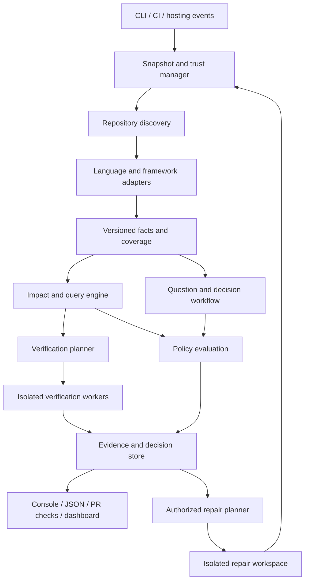

# Repository Assurance Platform — Implementation Plan

Status: implementation roadmap. The first local alpha is implemented; see `docs/capabilities.md` and `ROADMAP.md` for current scope. Later milestones remain planned.

Prepared: 16 October 2026.

Intended public GitHub owner: `samarth0211`.

Project name: **Repo Assurance**. Repository slug: `repo-assurance`. Package publication and trademark availability are separate matters from the public source repository.

## 1. Purpose and product commitment

Build a free, open-source, self-hosted platform that helps teams understand an existing codebase, enforce explicit engineering requirements, coordinate safe integration of concurrent changes, and progressively repair verified problems.

The platform must remain useful when a repository exceeds one million lines and cannot fit into an AI context window. Persistent, versioned program facts and reproducible checks are the foundation. AI assistance is optional.

The product commitment is:

> Every enforced decision identifies the exact code and policy it evaluated, the evidence it used, and the limits of its analysis.

Do not market the platform as detecting whether a human or AI wrote code, preventing every defect, proving general scalability, or automatically understanding every business requirement. Those claims are not supportable. “Vibe coding” describes a development process, not an objectively detectable property of a source file.

The intended outcome is stronger engineering practice for code written by anyone.

## 2. Constraints and operating assumptions

1. No required paid API, proprietary analysis service, hosted database, or managed application backend.
2. Users can run the software with their own infrastructure and keep source code within their environment.
3. No mandatory external source-code upload and no telemetry by default.
4. Start with one language ecosystem and publish the exact capability boundary.
5. Existing repositories can onboard without first reorganizing their source tree.
6. An incomplete mandatory analysis cannot silently count as a successful check.
7. Existing technical debt is visible and manageable separately from newly introduced violations.
8. Changes to policies, exceptions, baselines, and enforcement workflows are themselves protected changes.
9. The initial implementation is a modular application, not a fleet of microservices.
10. Scale and precision are benchmarked properties, not launch slogans.
11. No automatic changes to application behavior during onboarding.
12. A project maintainer can explicitly authorize staged repair work; repair permissions are separate from analysis permissions.

Free software does not eliminate electricity, compute, storage, support, or maintenance costs. The sustainable initial distribution model is software that organizations execute themselves. This project does not promise a free centrally hosted analysis service for every repository.

## 3. Users and primary workflows

| User | Main job | Expected interface |
|---|---|---|
| Individual maintainer | Inspect a repository and prevent new defects | CLI and local report |
| Developer | Understand and resolve findings on a change | CLI, PR check, evidence links |
| Repository owner | Configure boundaries and introduce enforcement | Configuration, onboarding report |
| Engineering lead | Prioritize debt and approve architecture decisions | Reports, later dashboard |
| Security/platform engineer | Control execution, trust, and integrations | Deployment configuration and audit log |
| Large organization | Coordinate policies across repositories | Self-hosted service and repository integrations |
| Open-source contributor | Add analyzers and improve correctness | Public schemas, fixtures, contributor documentation |

Core workflows:

- Assess a previously unknown repository without modifying application code.
- Establish a baseline and block selected new violations.
- Explain why a check failed, including dependency paths where available.
- Ask an owner a specific question when intent cannot be recovered from evidence.
- Validate a PR against the current integration candidate, not an obsolete main branch.
- Create and verify an authorized repair branch.
- Track whether analysis coverage and engineering debt are improving.

## 4. Release boundaries

| Release | Included | Explicitly deferred |
|---|---|---|
| Planning | Architecture, threat model, milestones, acceptance criteria | Product implementation |
| v0.1: local assessment | TypeScript/JavaScript discovery, module graph, explicit boundary rules, evidence reports, baseline | Whole-program dead-code proof, automatic repair, hosted service |
| v0.2: change enforcement | Trusted CI integration, revision-bound results, strict branch freshness, baseline governance | Custom merge queue, autonomous merging |
| v0.3: persistent intelligence | Durable facts, correct incremental invalidation, bounded workers, reconciliation | Universal language support |
| v0.4: onboarding intelligence | Entry-point adapters, targeted questions, qualified reachability analysis | General business-intent inference |
| v0.5: controlled repairs | Narrow transformations, repair plans, isolated branches, verification | Whole-repository autonomous rewrite |
| v0.6: organization service | Dashboard, scheduler, authorization, multi-repository metadata | Unverified enterprise-readiness claims |
| v1.0 candidate | Published support matrix, benchmark evidence, operational documentation, successful pilots | Guarantees of zero defects |

Versions communicate scope rather than promised dates. A milestone advances when its acceptance gate passes. Implementation effort should be estimated after the first working vertical slice and performance measurements.

## 5. Product placement and deployment modes

### 5.1 Inside each analyzed repository

Store reviewable intent, not generated indexes:

```text
.assurance/
  config.json
  architecture.json
  baseline.json
  exceptions.json
  decisions/
    <decision-id>.md
```

Some files may be introduced only when needed. Configuration is schema-validated, versioned, and documented. Generated reports and caches are excluded from normal source commits.

### 5.2 Local mode

A CLI discovers the checkout, analyzes it, and writes results into an explicitly selected local state directory. A user can run useful checks without GitHub access, a service, a model, or a network connection once dependencies are installed.

### 5.3 CI mode

The same engine analyzes an immutable revision or integration candidate in an isolated CI workspace. CI publishes a single required gate and downloadable reports. Trust decisions come from protected configuration, not arbitrary files supplied by the PR.

### 5.4 Organization mode

A company runs a control service, persistent metadata storage, artifact storage, and a bounded set of isolated workers. The service schedules work and publishes results; workers read source and perform analysis. Start with one deployable service plus workers and split components only when measurements justify it.

### 5.5 Git hosting

Git remains the source/history system. GitHub is the first hosting integration. Keep core analysis independent of GitHub so GitLab, Bitbucket, and locally hosted Git can be added later.

## 6. Proposed technical foundation

These are initial engineering choices to validate, not claims that every dependency has already been selected.

| Concern | Initial choice | Rationale and revisit condition |
|---|---|---|
| Core language | TypeScript on a supported Node.js LTS | Shares types with the first compiler adapter; revisit worker hotspots after profiling |
| First language adapter | TypeScript Compiler API | Resolve modules, symbols, and configuration with language-aware tooling |
| Public interchange | Versioned JSON schemas; evaluate SCIP import/export | Prevent internal implementation from becoming the integration contract |
| CLI | Minimal command parser and structured output | Keep local use and automation simple |
| Initial state | JSON reports; content-addressed local artifacts | Easy inspection before a durable database is required |
| Durable local metadata | Evaluate SQLite at v0.3 | Indexed facts and transactions without a mandatory server |
| Organization metadata | Evaluate PostgreSQL when multi-worker access is needed | Shared transactions and concurrency; do not ship an untested storage abstraction prematurely |
| Graph representation | Typed relationships in indexed tables | A graph data model does not require a graph database |
| Initial tests | Compiler fixtures, integration tests, CLI tests | Verify observable properties and failure cases |
| Report formats | Console and JSON first; SARIF later | CLI portability before platform-specific presentation |
| Service/dashboard | Choose after the CLI schema stabilizes | Avoid building a UI around an unstable data model |
| Packaging | CLI package and optional OCI image | Support both developer machines and isolated execution |

The [TypeScript Compiler API documentation](https://github.com/microsoft/TypeScript/wiki/Using-the-Compiler-API) provides the starting point for compiler-backed analysis. Pin and test the compiler version because compiler API behavior can change.

[SCIP](https://scip-code.org/) is an existing code-intelligence protocol. Evaluate it for interoperable symbol information; it is not by itself an authorization analyzer, data-flow engine, or architectural policy system. Review [the protocol license](https://github.com/scip-code/scip/blob/main/LICENSE) and each adapter's license separately.

Do not make an embedding database, an LLM, Kubernetes, Redis, or a commercial scanner prerequisites for v0.1.

## 7. Logical architecture



Responsibilities must stay separate:

- Snapshot manager: identifies exact inputs and establishes trust boundaries.
- Discovery: inventories source, packages, configuration, and exclusions.
- Adapters: produce facts with their provenance and coverage limitations.
- Fact store: persists data and provides consistent snapshots.
- Impact engine: computes affected regions and invalidates stale results.
- Policy engine: evaluates explicit requirements against facts and evidence.
- Verification planner: chooses tests/build checks and records selection rationale.
- Worker supervisor: enforces execution boundaries, budgets, cancellation, and cleanup.
- Decision engine: combines mandatory check outcomes without hiding uncertainty.
- Question workflow: captures unresolved intent and owner decisions.
- Repair workflow: proposes and validates separately authorized changes.
- Integration layer: communicates results without deciding analysis semantics.

## 8. Repository discovery and immutable snapshots

### 8.1 Discovery steps

1. Resolve the requested repository root and prevent paths from escaping it.
2. Determine whether the input is a Git revision, a clean checkout, or a dirty working tree.
3. Record commit identity and content hashes. Dirty working trees require a content manifest, not just a Git SHA.
4. Enumerate tracked source and explicitly included files; distinguish ignored, excluded, generated, and unsupported material.
5. Identify workspace manifests, package managers, lockfiles, compiler configurations, build definitions, and generated-source rules.
6. Discover package boundaries and framework conventions.
7. Record submodules, Git LFS pointers, symlinks, and missing dependencies rather than silently assuming their contents.
8. Validate configuration and publish a scope summary before lengthy analysis.

The default PR gate analyzes a committed candidate. Local working-tree analysis is allowed but must not be presented as evidence for a different committed revision.

### 8.2 Hard cases

- Never follow symlinks outside the allowed workspace.
- Normalize paths across Windows and Linux; preserve case where needed and detect case collisions.
- Distinguish declaration files, generated files, fixtures, tests, scripts, and application source.
- Allow explicit exclusion with visible coverage consequences.
- Treat missing private packages or incomplete submodules as missing inputs.
- Detect changes during scanning. Retry or report an unstable snapshot rather than mixing revisions.
- Apply documented file-size, file-count, memory, and wall-time budgets. Exhaustion produces an explicit partial result.
- Do not execute package installation hooks, repository build scripts, or code generators just to discover files.

### 8.3 Acceptance

For identical immutable inputs and tool versions, discovery produces the same ordered manifest and scope classification. No omitted source is silently counted as analyzed.

## 9. Fact model and graph semantics

Define schemas before distributed execution. Each fact is associated with a repository, snapshot, producer, producer version, and source provenance.

| Entity | Important fields |
|---|---|
| Repository | ID, allowed root/origin, default branch, trust configuration |
| Snapshot | Commit/tree identity, dirty manifest if applicable, configuration/dependency digests |
| File | Normalized path, content hash, role, language, inclusion status |
| Package | Manifest, version, workspace membership, public entry points |
| Symbol | Adapter-scoped stable identity, kind, definition, visibility, signature hash |
| Relationship | Source, target, relation type, location, resolution status, producer |
| Entry point | Kind, declaring evidence, owning application, validity scope |
| Coverage record | Capability, analyzed scope, missing inputs, unsupported constructs |
| Policy | Stable ID, version, applicability, severity, evidence requirement |
| Finding | Rule identity, semantic fingerprint, locations, evidence references, confidence category |
| Check run | Exact input manifest, status, duration, resource usage, artifact references |
| Baseline item | Fingerprint, accepted revision, policy version, owner/reason where required |
| Exception | Narrow scope, owner, justification, authorization, expiry |
| Question | Evidence, affected decisions, assignee, answer state |
| Repair | Authorized scope, source revision, patch identity, validation results |

Relationships include `imports`, `reexports`, `references`, `implements`, `calls`, `owns`, and later `produces`/`consumes` contract relationships. These have different semantics; an import graph must never be presented as a complete call graph.

Call targets and data flows can be unresolved or over-approximated. Record this explicitly. Keep type-only dependencies distinct from runtime dependencies. Symbol identities may change during refactoring, so cross-revision correspondence requires evidence rather than assuming IDs never change.

Publish new snapshots transactionally. Readers must not observe a graph with half of one revision and half of another.

## 10. Policy model and decision semantics

Every policy specifies:

- Its purpose, scope, and applicability conditions.
- Which capabilities and evidence are required.
- Its severity and enforcement mode.
- Its treatment of baseline findings and exceptions.
- Its behavior when analysis is incomplete.
- How an engineer can reproduce the result.

Proposed policy families:

| Family | Examples | Evidence required |
|---|---|---|
| Architecture | Forbidden imports, allowed layer direction, dependency cycles | Resolved dependency paths |
| Build/type correctness | Compilation and type checks | Tool output for the candidate |
| API compatibility | Removed or incompatible declared public contract | Versioned contract comparison |
| Security | Recognized unsafe flow or violated explicit security rule | Dedicated analyzer/test evidence, not intuition |
| Verification | Critical behavior has required checks | Declared mapping and execution results |
| Data changes | Migration presence and staged compatibility | Schema/migration analysis plus appropriate tests |
| Reachability | Apparently unreachable internal code | Entry-point model and graph coverage |
| Governance | Unauthorized baseline expansion or policy weakening | Trusted-base comparison and review authorization |

Initial blocking policies should be deterministic and narrow. General design suggestions remain advisory until they can be expressed and validated reliably.

### 10.1 Check states

- `PASS`: the declared requirement was satisfied for the stated scope and assumptions.
- `FAIL`: evidence establishes a violation.
- `INCONCLUSIVE`: required evidence is unavailable, unsupported, inconsistent, or analysis failed.
- `NOT_APPLICABLE`: applicability was explicitly established as false.

Execution lifecycle states such as queued/running/cancelled are separate. A cancelled or timed-out required check cannot become `PASS`.

### 10.2 Aggregate gate

- Any unsuppressed mandatory failure blocks.
- Any mandatory inconclusive result blocks unless an authorized policy explicitly permits an audited override.
- Advisory findings do not block.
- Baseline and exception handling remains visible in the report.
- No configured applicable checks is reported explicitly; a misconfigured mandatory gate must not pass vacuously.

Proposed CLI exit codes: `0` permitted under the active policy, `1` blocked by a verified violation, `2` inconclusive/operational failure. The machine-readable report remains the authoritative explanation. Observational mode may exit successfully while prominently recording that enforcement was disabled.

## 11. Finding identity, baselines, and exceptions

### 11.1 Finding identity

Use semantic fingerprints based on rule, relevant symbols or dependency edges, and normalized context. Line numbers are supporting locations, not primary identity. A line insertion must not transform every existing finding into a new one.

A rule-semantic version change can invalidate matching assumptions. Version migrations must be explicit.

### 11.2 Baseline behavior

The initial assessment can record verified existing findings. Future gates compare individual findings against a trusted baseline.

- Baseline 430 specific findings, not an allowance of 430 arbitrary violations.
- Removing one old violation does not permit introducing another.
- Record active, resolved, and disputed items separately.
- Expanding a baseline is an explicit governed operation, never an automatic repair.
- Prevent resolved violations from silently returning: retire their active exemption through a controlled update, or maintain an authoritative baseline lifecycle in service mode.
- In CLI-only mode, require the resolved-exemption cleanup workflow before claiming protection against reintroduction. Document the limitation until that lifecycle exists.
- Do not baseline analyzer crashes, missing coverage, or unsupported security assumptions as ordinary code defects.

### 11.3 Exceptions

Exceptions must identify the exact rule and narrow scope, an owner, a reason, an expiry, and appropriate authorization. Broad wildcard exceptions need elevated review. Expiry must be deterministic, and reports must surface approaching expiration.

PR-supplied configuration cannot authorize its own new exceptions. Evaluate current enforcement using trusted target-branch policy, while separately showing the proposed policy change. A policy update takes effect through a deliberate protected process.

## 12. Incremental analysis without stale knowledge

v0.1 uses full analysis within its supported scope. Establish a correct reference implementation before optimizing it.

For v0.3:

1. Compare the new manifest with the last compatible snapshot.
2. Recompute changed file facts.
3. Invalidate relationships affected by removals, moves, changed exports, or resolution changes.
4. Traverse relevant reverse dependencies and contract consumers.
5. Recompute global policies affected by the update, such as cycles and reachability.
6. Reuse a cached result only when its declared inputs are unchanged.
7. Publish the completed snapshot atomically.
8. Periodically compare incremental output with a clean full analysis.

Cache identities include source content, relevant compiler/build configuration, lockfiles or resolved dependency manifests, adapter versions, rule versions, framework model versions, entry-point declarations, and applicable environment assumptions.

Broad changes can invalidate broad regions: compiler options, dependency resolution, code-generation definitions, framework conventions, public contracts, and policy edits. For uncertain impact, expand analysis; do not guess that unchanged files are unaffected.

Use per-file/package immutable artifacts and snapshot overlays to avoid duplicating an entire million-line index for each open PR. Specify retention and garbage collection before enabling unlimited snapshot storage.

The central correctness test is equivalence of full and incremental results for a controlled sequence of edits, including failed and interrupted updates.

## 13. Dead-code and reachability analysis

Dead-code detection is a later capability with an explicit model, not a launch guarantee.

### 13.1 Establish roots

Recognize application bootstraps, routes, scheduled jobs, command entry points, event consumers, package exports, plugin registrations, tests, and framework-generated entry points. Distinguish production reachability from test-only reachability.

### 13.2 Classify results

| Classification | Meaning | Default action |
|---|---|---|
| Reachable | A modeled path exists from a known root | Preserve |
| Apparently unreachable | No modeled path exists and relevant analysis completed | Advisory removal candidate |
| Unknown | Dynamic behavior or missing information prevents a conclusion | Ask or improve the model |
| Externally exposed | Consumers may exist outside analyzed repositories | Require consumer/compatibility decision |

Dynamic imports, reflection, dependency injection, native calls, configuration references, plugin loaders, generated code, and external customers require special handling. Runtime non-observation can support a finding but cannot prove permanent non-use.

Framework adapters must have fixture coverage. Existing tooling such as Knip can inform integration and test cases; its documentation demonstrates why missing entry points produce false positives. See [Knip's issue-resolution guidance](https://knip.dev/guides/handling-issues).

No automatic deletion of externally exposed or unknown-reachability code. Even a strong local removal candidate goes through change validation.

## 14. Existing-repository onboarding and questions

### 14.1 Onboarding sequence

1. Read-only discovery and trust/capability checks.
2. Progressive inventory report, including unsupported regions.
3. Initial full assessment within supported scope.
4. Explain differences between missing environment access and actual code defects.
5. Ask owners to resolve questions that materially affect interpretation.
6. Establish an explicit architecture contract and a reviewed baseline.
7. Observe proposed gate decisions without blocking.
8. Enable a small set of verified mandatory rules.
9. Expand enforcement after measuring false positives and operational cost.

Installation must not require an immediate application rewrite. A severely broken repository may first need reproducible build work before deeper behavioral checks are meaningful.

### 14.2 Question object

Each question includes the unresolved fact, concrete evidence, why it matters, affected proposed changes, suggested answers if appropriate, owner, priority, and dependencies blocked by the answer.

Example:

> `packages/legacy-billing` has no internal callers but is published as a package. Do external consumers still depend on it? Removing it is paused until the owner answers.

### 14.3 Answer lifecycle

Store an answer as a scoped, versioned decision with author and rationale. Reopen it when supporting code or assumptions change. Silence is not agreement. A speculative model answer is never authoritative business intent. Continue independent work while a question is pending.

Deduplicate questions, group related decisions, and prioritize high-impact blockers to avoid overwhelming maintainers.

## 15. Concurrent PRs, stale approvals, and merge safety

### 15.1 Separate review from integration clearance

Human approval and machine integration clearance are separate records. A human may have approved an unchanged diff, while checks against an old base are no longer sufficient.

Every integration result binds to at least:

- Repository and target branch.
- PR head revision.
- Target revision and candidate tree identity.
- Merge strategy or integration method.
- Trusted configuration, baseline, and exception digests.
- Analyzer/rule versions and relevant verification environment.

If these inputs change, determine which evidence remains valid. Never attach an old success to a different candidate merely because the PR number is unchanged.

### 15.2 Five concurrent PRs

Analyze independently in isolated workspaces, sharing only immutable trusted artifacts. Detect likely interaction through affected contracts and dependency regions. Keep findings advisory until candidate verification establishes a blocking issue.

Integration must validate the actual combination in queue order. Disjoint textual diffs are not proof of behavioral independence.

### 15.3 Approved PR waiting five days

If A passed against M100 and ten PRs move main to M110, require checks for the candidate composed from M110 and A. Reuse only valid evidence. Re-review is required when protected review policy or material changes demand it; unrelated changes do not intrinsically require a human to reread everything.

If main changes again before integration, the merge authority must enforce freshness and rebuild/revalidate as necessary. A webhook reacting after an unsafe merge is too late.

### 15.4 First GitHub integration

For a public repository under the personal account `samarth0211`, begin with required status checks, strict up-to-date branch requirements, protected policy changes, and controlled bypass access.

GitHub documents public-repository branch protection and strict versus loose freshness checks in [its protected-branch documentation](https://docs.github.com/en/repositories/configuring-branches-and-merges-in-your-repository/managing-protected-branches/about-protected-branches).

Do not assume GitHub's native merge queue is available on a personal account. Its current documentation lists public repositories owned by organizations, and private organization repositories on Enterprise Cloud. See [GitHub merge queue availability](https://docs.github.com/en/repositories/configuring-branches-and-merges-in-your-repository/configuring-pull-request-merges/managing-a-merge-queue).

For eligible repositories, support the native queue and its `merge_group` checks. For other repositories, retain strict freshness enforcement. A custom queue is optional later work, not a prerequisite and not a v0.2 promise.

### 15.5 Future custom queue requirements

Only build one if there is demonstrated demand. It needs durable queue state, target-branch serialization, cancellation, crash recovery, idempotent hosting operations, fairness, and a hosting mechanism that conditionally integrates only the validated state. A read-then-merge API sequence alone does not eliminate a race. Prove the chosen integration mechanism with adversarial concurrency tests before claiming safe queue behavior.

## 16. Repair and modernization workflow

### 16.1 Permissions

Separate permissions for assessment, proposed plans, creating branches/PRs, and applying approved repairs. The default is assessment only. No unrequested pushes, merges, database operations, or application deployments.

### 16.2 Repair plan

Each proposed repair identifies a verified problem, target property, touched scope, dependent owner decisions, behavior to preserve, risk class, verification steps, and rollback approach.

Example repair classes, in increasing risk:

1. Correct a deterministic configuration error.
2. Update a resolved import during an explicitly requested module move.
3. Remove a verified unused internal export with appropriate validation.
4. Extract duplicated logic after checking behavior differences.
5. Change a public interface through a compatibility transition.
6. Change persistent data through a staged migration.

Start with a small set of deterministic transformations. Do not begin with an autonomous architecture-rewrite agent.

### 16.3 Execution

- Work from an immutable source revision in an isolated branch/worktree.
- Capture relevant existing behavior and contracts before changing them.
- Recognize that characterization tests preserve observed behavior, which may itself be incorrect.
- Apply one bounded change at a time.
- Verify compilation, relevant tests, policies, and expected graph changes.
- Ensure the patch does not weaken checks to conceal its failure.
- Stop or replan when assumptions change; do not stack speculative patches.
- Open a reviewable PR with evidence and limitations when authorized.
- Revalidate through the normal merge boundary.

Rollback of a code patch and rollback of a production data migration are different operations. Persistent-data repair requires a dedicated compatibility and recovery plan.

### 16.4 No reliable behavior oracle

If the repository lacks tests and owners cannot specify expected behavior, the platform may improve observability and testability first. It must not label a sweeping rewrite safe just because newly generated tests pass.

## 17. Security and trust model

The system will inspect untrusted source and may eventually execute repository commands. Its own security is a launch requirement for shared execution.

| Threat | Required mitigation |
|---|---|
| PR modifies its own policy or baseline | Read enforcement configuration from a trusted base; separately review proposed edits |
| PR replaces the analyzer or gate script | Pin trusted engine/workflow source; protect enforcement definitions |
| Repository scripts execute malicious code | Separate static inspection from execution; run commands only in approved isolation |
| Fork PR accesses credentials | Do not expose write tokens or secrets to untrusted execution |
| Poisoned cache produces a green result | Partition trust domains; validate manifests and artifact provenance |
| Forged report is published | Only trusted orchestration publishes authoritative checks; schema validation alone is insufficient |
| Dependency installation executes hooks | Disable where possible; require explicit execution policy and isolation |
| Resource exhaustion | CPU/memory/time/disk/process limits, bounded queues, cancellation |
| Path traversal or symlink escape | Canonicalize and enforce workspace/artifact boundaries |
| Duplicate/out-of-order webhook | Verify signature, deduplicate, and reconcile authoritative hosting state |
| Dashboard leaks source | Access control, safe rendering, redaction, retention controls |
| Model follows instructions embedded in code | Treat repository content as untrusted data; separate model outputs from authority |

Static parsing is not risk-free: parser and dependency vulnerabilities remain possible. Shared workers still require isolation and updates.

Do not execute untrusted PR code in a privileged `pull_request_target` workflow. Follow GitHub's [secure-use guidance](https://docs.github.com/en/actions/reference/security/secure-use). Prefer ephemeral execution environments for public contributions and never expose company networks to arbitrary public-fork workloads.

Use least-privilege integration credentials. Analysis does not require merge authority. Writing a finding, creating a repair PR, and changing branch protection are separate privileges.

Implement retention/deletion and redaction. Code indexes, symbol names, and reports may contain proprietary information even when full source text is absent.

## 18. Large-repository engineering

One million lines is a useful benchmark milestone, not a complete workload description. Also measure files, packages, symbols, edges, generated content, languages, dependency fan-out, configuration complexity, and concurrent changes.

### 18.1 Strategies

- Partition extraction by compiler project/package where correctness permits.
- Bound compiler processes and worker concurrency; do not spawn one worker per package without a budget.
- Stream fact production and batch database writes.
- Keep query indexes for reverse dependencies and policy lookups.
- Use immutable artifacts and branch overlays.
- Avoid loading the entire graph into memory for every query.
- Checkpoint long jobs and resume only from compatible inputs.
- Cancel obsolete PR jobs, with fairness to prevent permanent starvation on busy branches.
- Apply artifact retention and storage quotas.
- Record partial coverage rather than silently dropping expensive regions.

### 18.2 Benchmark matrix

| Dimension | Required cases |
|---|---|
| Size | Small fixtures; approximately 100k; approximately 1m+ source lines |
| Structure | Single package, multi-project workspace, deep dependency chain, high fan-out |
| Change | Function body, exported type, package move, deletion, lockfile/configuration change |
| Environment | Cold cache, warm cache, missing dependencies, constrained memory |
| Concurrency | 1, 5, and 20 PR analyses; target branch changing during checks |
| Failure | Worker crash, timeout, interrupted storage write, corrupt artifact |

Record hardware, OS, tool versions, repository commit, included scope, and complete commands. Do not pad line counts with generated/vendor code and imply equivalent language complexity.

### 18.3 Reported metrics

Cold/warm runtime, CPU time, peak memory, disk/index size, cache reuse, affected scope, incremental/full equivalence, coverage gaps, verified false positives, known missed cases, queue wait, and stale-candidate rejection rate.

Set enforceable performance targets after the first baseline measurements. Publish results including failures. Do not predeclare arbitrary sub-minute million-line analysis as a requirement without evidence.

## 19. Verification and test strategy

This product makes enforcement decisions, so correctness tests are part of the core implementation.

| Test layer | Important scenarios |
|---|---|
| Discovery fixtures | Ignored/tracked files, symlinks, case differences, submodules, dirty trees |
| Language fixtures | Reexports, aliases, type-only imports, project references, dynamic imports |
| Policy fixtures | Allowed boundary, direct/transitive violation, cycle creation/removal |
| Baseline fixtures | Line shifts, same-count substitution, resolved issue returning, unauthorized expansion |
| Incremental equivalence | Randomized edit sequences compared with full recomputation |
| Trust tests | Malicious config, workflow edits, forged artifacts, secret isolation |
| CI integration | Exact candidate checks, missing required evidence, report publication failure |
| Concurrency tests | Simultaneous PRs, stale bases, force pushes, queue recovery |
| Repair tests | Behavior preserved, changed assumptions, unsafe patch rejected, rollback |
| Scale tests | Bounded memory, cancelled jobs, resume compatibility, garbage collection |

Mutation-style scenarios must introduce a known violation and demonstrate that the gate blocks it. A test suite that only checks report formatting is insufficient.

Security checks need known vulnerable and safe examples. Authorization or transaction correctness cannot be inferred merely from the presence of a function named `authorize` or `transaction`.

Validate on consented or appropriately licensed public repositories. Synthetic fixtures establish known answers; real repositories establish usability and operational limits. Keep a labeled evaluation set and avoid tuning solely to the demonstration examples.

Run the platform against its own repository once its applicable checks exist. Self-use supplements independent tests; it does not prove correctness.

## 20. Developer experience and proposed CLI

The commands below describe the intended interface. They are not installed or implemented yet.

```text
assurance init                         # create proposed configuration, explicitly requested
assurance doctor                       # prerequisites, trust and coverage diagnostics
assurance scan                         # read source; write separate analysis artifacts
assurance explain <finding-id>         # evidence and reproduction details
assurance baseline create              # explicit initial debt acceptance operation
assurance baseline reconcile           # propose resolved-item retirement
assurance check --base <revision>       # evaluate a change under trusted configuration
assurance questions list               # unresolved owner decisions
assurance decisions record             # persist an authorized scoped answer
assurance repair plan <finding-id>      # propose work without application edits
assurance repair prepare <plan-id>      # authorized isolated branch and verification
```

Every mutating command states what it will change and supports a preview where useful. Source analysis must not silently install dependencies, alter policies, or fix application code.

Example report:

```text
Gate: BLOCKED
Candidate: <candidate-identity>
Policy: <trusted-policy-digest>
Scope: 84 packages; 9,214 source files
Coverage: module boundaries complete; dynamic reachability not evaluated

New mandatory violations: 2
Existing baseline findings: 117
Mandatory inconclusive checks: 0
Advisory findings: 9

ARCH-001: web imports a forbidden persistence module
Evidence: apps/web/checkout.ts -> packages/storage/orders.ts
Resolution: use the approved application interface or request a policy review
```

Use descriptive findings rather than an unexplained “vibe score.” A single numeric score can conceal a critical failure behind many successful low-risk checks.

## 21. Proposed project repository structure

Create only the directories needed by each milestone; this tree describes the eventual boundaries.

```text
repo-assurance/
  README.md
  LICENSE
  SECURITY.md
  CONTRIBUTING.md
  CODE_OF_CONDUCT.md
  CHANGELOG.md
  IMPLEMENTATION_PLAN.md
  docs/
    architecture/
    decisions/
    policies/
    deployment/
    threat-model.md
    capability-matrix.md
    limitations.md
  packages/
    cli/
    core/
    schemas/
    analyzer-typescript/
    policy-engine/
    storage/                 # introduced with persistent indexing
    integration-github/      # introduced with CI integration
    repair/                  # introduced after enforcement is reliable
  apps/
    service/                 # later organization deployment
    dashboard/               # later organization interface
  tests/
    fixtures/
    integration/
    security/
  benchmarks/
    manifests/
    runners/
    results/
  examples/
    small-repository/
    existing-monorepo/
  .github/
    workflows/
    ISSUE_TEMPLATE/
    PULL_REQUEST_TEMPLATE.md
```

Avoid creating empty packages solely to match this diagram. Maintain an explicit internal dependency direction: schemas/core below adapters, policies, and presentation; core must not import GitHub-specific logic.

## 22. Milestones, deliverables, and exit criteria

### M0 — Project specification and governance

Deliverables:

- This plan, the MIT license decision, capability matrix, threat-model draft, and first architecture decisions.
- Scope of the first supported TypeScript/JavaScript project shapes.
- Public roadmap with honest limitations and contribution rules.

Exit: reviewers can explain what v0.1 will verify, what it cannot verify, and how each blocking decision will be reproduced.

### M1 — First complete local analysis slice

Deliverables:

- CLI with schema-validated configuration and deterministic JSON output.
- Immutable input manifest and source discovery.
- TypeScript-aware module resolution for the explicitly supported project shape.
- One forbidden-dependency policy with evidence.
- Clear incomplete-analysis behavior.

Exit: an allowed fixture passes; a forbidden import fails; an unresolved required input produces inconclusive; repeated runs are reproducible; no source files are modified.

### M2 — Existing-repository assessment

Deliverables:

- Workspace support with a published support matrix.
- Dependency cycles and explicit layer boundaries.
- Finding identity, baseline creation, comparison, reconciliation, and scoped exceptions.
- Doctor/explain commands and coverage reports.
- Small real-repository pilots.

Exit: a messy repository can onboard in observation mode; exact existing findings can be accepted; a different new violation cannot hide behind an old count; unsupported regions remain visible.

### M3 — Trusted GitHub enforcement

Deliverables:

- CI integration with trusted engine/configuration handling.
- Required aggregate gate with exact candidate identity.
- Strict branch-freshness setup and native queue support where available.
- Policy/baseline change governance.
- Fork-PR and concurrent-change integration tests.

Exit: the five-day-old PR scenario cannot use obsolete clearance; a PR cannot relax its own policy to pass; incomplete mandatory checks block; no untrusted job has privileged credentials.

### M4 — Persistent incremental intelligence

Deliverables:

- Durable fact schema, transactions, immutable artifacts, branch overlays.
- Dependency-aware invalidation and cache provenance.
- Full-analysis reconciliation, bounded worker supervision, resume and retention.
- Published benchmark harness.

Exit: incremental and full results agree for the supported evaluation corpus; interrupted jobs do not publish mixed snapshots; resource limits are enforced; incompatible cache artifacts are rejected.

### M5 — Framework reachability and owner questions

Deliverables:

- Initial framework entry-point adapters chosen from pilot demand.
- Qualified unused-code candidates with evidence and unknown-state handling.
- Question/decision lifecycle and owner assignment.
- External-consumer/public-export handling.

Exit: missing entry points cause explicit uncertainty; unsupported dynamic code is not silently deleted or declared unused; recorded decisions are scoped and can be invalidated.

### M6 — Controlled repair workflow

Deliverables:

- Repair plans with preconditions and authorized scope.
- A small set of deterministic transformations.
- Isolated repair branches, before/after verification, and rollback guidance.
- Optional PR preparation with least-privilege integration.

Exit: every repair is reproducible and bounded; failed verification prevents application; policy weakening is rejected; behavior ambiguity pauses dependent work.

### M7 — Organization deployment and scale qualification

Deliverables:

- Scheduler, dashboard, authorization, audit log, and deployment documentation.
- Backup/restore, schema migration, upgrades, artifact retention, and worker lifecycle.
- Multi-repository dependency/version metadata.
- Million-line benchmark results and at least one substantial pilot with documented feedback.

Exit: published workload evidence supports the claimed scale; simultaneous PRs remain isolated; crash recovery and restore are exercised; deployment can run without a paid hosted dependency.

### M8 — v1.0 release review

Deliverables:

- Stable public schemas or documented compatibility policy.
- Security review and outstanding-risk register.
- Installation, upgrade, uninstall, and troubleshooting guides.
- Reproducible release process, dependency/license inventory, and release notes.
- Maintainer support expectations and vulnerability-reporting process.

Exit: capabilities, limitations, operating costs, and support expectations are documented and consistent with observed behavior. Enterprise suitability remains deployment- and requirement-specific.

## 23. Initial implementation backlog

These are proposed issues, not GitHub issues already created.

| ID | Work item | Depends on | Acceptance evidence |
|---|---|---|---|
| SPEC-001 | Define capability/result schemas | M0 decisions | Valid/invalid schema fixtures |
| SPEC-002 | Define trust model and policy provenance | M0 decisions | Threat scenarios and expected decisions |
| CORE-001 | Snapshot manifest and path safety | SPEC-001 | Stable manifests, dirty-tree and symlink tests |
| DISC-001 | Git-aware source inventory | CORE-001 | Included/excluded/missing-input fixtures |
| TS-001 | Compiler configuration and module resolution | DISC-001 | Alias, reexport, declaration and failure fixtures |
| GRAPH-001 | Typed module dependency representation | TS-001 | Correct directed graph and provenance |
| RULE-001 | Forbidden dependency rule | GRAPH-001, SPEC-002 | Allowed/failing/inconclusive examples |
| REPORT-001 | JSON and console evidence output | RULE-001 | Reproducible report and exit behavior |
| CLI-001 | Scan and doctor commands | REPORT-001 | Clean-machine CLI integration test |
| RULE-002 | Cycle detection with paths | GRAPH-001 | Cycle creation/removal fixtures |
| BASE-001 | Semantic finding identity and baseline comparison | RULE-001 | Line shift and same-count substitution tests |
| BASE-002 | Reconciliation and exception lifecycle | BASE-001 | Resolved issue reintroduction/expiry scenarios |
| CI-001 | Trusted PR analysis and aggregate gate | CLI-001, SPEC-002 | Malicious-config and fork-PR tests |
| CI-002 | Candidate freshness integration | CI-001 | Ten intervening merges invalidate clearance |
| STORE-001 | Persistent transactional snapshots | Stable schemas | Crash/rollback and migration tests |
| INC-001 | Incremental invalidation | STORE-001 | Full/incremental equivalence corpus |
| PERF-001 | Resource and scale harness | CLI-001 | Reproducible versioned benchmark output |
| DOC-001 | Existing-repository onboarding guide | M2 behavior | Independent maintainer completes setup |

Implement the first end-to-end path before expanding the backlog: snapshot -> discover -> resolve -> one rule -> evidence -> CLI result. This makes the product concrete and tests the architecture early.

## 24. Open-source publication and sustainability

### 24.1 Publication sequence

1. Finish the planning review and settle the working name.
2. Prepare the first repository contents locally and inspect them for credentials, personal files, and unsupported claims.
3. Use the MIT license selected by the owner, with its copyright and permission notice. Commercial redistribution is permitted.
4. Create the public repository under `samarth0211` when implementation/publication work is authorized.
5. Add README, license, contribution/security guidance, roadmap, and the first executable slice as milestones permit.
6. Configure repository-specific commit identity deliberately; do not accidentally publish using an unrelated active account.
7. Enable available branch protections and required checks; document remaining enforcement gaps.
8. Publish tagged prereleases with exact supported scope.

The plan itself does not create hosting infrastructure. Refer to the repository README and release records for publication status.

### 24.2 Free-use commitment

- Keep core assessment, policy enforcement, and supported self-hosted capabilities usable without a payment requirement.
- Do not place the safety-critical merge gate behind a paid API.
- Keep optional provider integrations optional.
- Document third-party licenses and capabilities; open-source availability does not imply every commercial feature is available without charge.
- Do not collect source or usage data without an explicit choice.
- Accept community contributions with clear review ownership and regression evidence.

The author can develop locally and use available community infrastructure, but external services have their own availability and usage limits. Do not base project sustainability on unlimited free CI or indefinite free hosted storage.

### 24.3 Maintenance

Define supported runtime/compiler versions, dependency update policy, vulnerability triage, schema compatibility, release ownership, and how maintainers handle false-positive reports. New analyzers need a responsible maintainer and a capability/test matrix before becoming mandatory gate inputs.

## 25. Risk register

| Risk | Consequence | Response |
|---|---|---|
| Scope expands to every language and every defect | No reliable release | Narrow first ecosystem and publish capability boundaries |
| Rules generate too many false positives | Teams disable the gate | Observation mode, evidence, labeled evaluation, narrow blocking rules |
| Unsupported analysis is treated as success | False confidence | Explicit coverage and inconclusive mandatory checks |
| Incremental cache becomes stale | Defects escape enforcement | Input provenance and continuous full/incremental comparisons |
| Baseline becomes a permanent bypass | Old problems can return | Lifecycle reconciliation and protected updates |
| Custom merge queue has races | Unvalidated combination merges | Prefer host mechanisms; prove conditional integration before release |
| Repairs preserve incorrect behavior or remove required code | Production regression | Owner intent, meaningful tests, small authorized patches |
| Worker executes hostile source | Credential/data compromise | Isolation, least privilege, trust separation |
| Index storage grows with every PR | Unbounded operating cost | Immutable sharing, retention, quota, garbage collection |
| Single-maintainer overload | Slow fixes and abandoned releases | Small core, clear contribution boundaries, no unsupported service promises |
| Enterprise features precede core accuracy | Attractive dashboard over unreliable results | Correctness milestone gates before organizational expansion |
| “Free” is interpreted as zero operational cost | Unsustainable expectations | Explain self-hosted cost ownership from the beginning |

## 26. Decisions to settle before implementation

These are decisions, not reasons to stop refining the plan. Recommended defaults allow the first prototype to proceed once implementation is requested.

| Decision | Recommended default | When it must be final |
|---|---|---|
| Public name/repository slug | Repo Assurance / `repo-assurance`, subject to availability | Before GitHub publication |
| License | MIT, selected by the owner; preserve third-party notices | Decided before public code release |
| First ecosystem | TypeScript/JavaScript | Before M1 implementation |
| First supported project shape | One compiler project, then explicit workspace/project-reference expansion | Before capability claims |
| First mandatory policy | Forbidden module/package dependency | Before M1 acceptance |
| Initial deployment | Local CLI, then CI | Before implementation packaging |
| Default enforcement | Observation until owner configures mandatory rules | Before onboarding release |
| Repair authority | None by default | Before any repair feature |
| Primary Git host | GitHub, core remains host-independent | Before M3 |
| Cloud business model | No central analysis service required | Product commitment |

## 27. Definition of a successful first public alpha

The first alpha is successful when an independent maintainer can:

1. Install and run the CLI without a paid service.
2. Understand exactly which files and capabilities were analyzed.
3. Configure and reproduce a concrete architectural rule.
4. Baseline specific existing violations without hiding new ones.
5. Obtain actionable evidence for a blocked change.
6. See failures and unsupported analysis clearly.
7. Run the documented required check in a protected repository workflow.
8. Verify that stale integration evidence cannot authorize a changed candidate.
9. Report a false positive with enough diagnostic information to reproduce it safely.

The alpha does not need an AI model, a dashboard, every language, a custom merge queue, or automatic architecture rewrites. Those additions must build on a trustworthy analysis and enforcement core.

## 28. Immediate next work after plan approval

1. Record the initial architecture decisions and capability boundary.
2. Scaffold the minimal CLI/core/TypeScript adapter with versioned schemas.
3. Implement immutable discovery and one deterministic boundary rule.
4. Add fixtures proving pass, fail, and inconclusive behavior.
5. Produce a reproducible console/JSON report on a small real repository.
6. Review the resulting implementation and public documentation before creating and publishing the GitHub repository.

This document remains the roadmap. Implementation progress and executed validation are tracked in the capability matrix, changelog, and validation record; planned features must not be described as already shipped.
